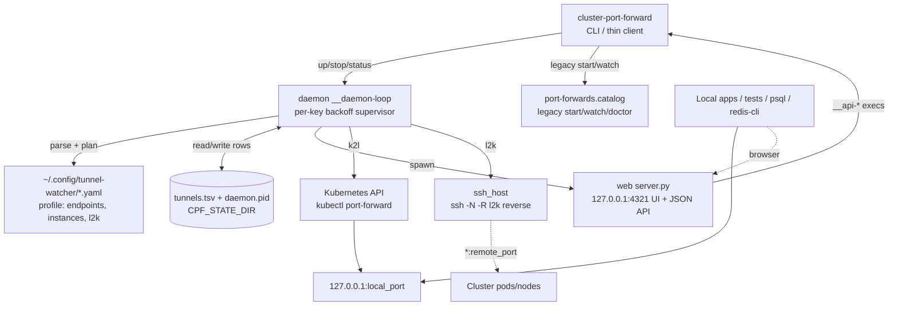

# port-forward-utils — Architecture

<!-- 〚📁:ec51fbcd-2e90-5920-ae4c-510bb8bb3f4f〛 PROJ-ARCH :: Architecture — catalog + tunnel-profile layers, daemon ownership, web/API, key decisions -->
## Overview

**port-forward-utils** is a pure-Bash package with one CLI,
`cluster-port-forward` (~2.3k lines), that keeps long-lived
`kubectl port-forward` tunnels alive for local tests against cluster
(prod-like) data: Timescale, Valkey, Weaviate, Qdrant, MinIO, Infisical, and
app backends.

Two management layers share one state store:

- **Catalog surface** (legacy): whitespace catalog (`share/port-forwards.catalog`)
  + foreground `start`/`watch` supervisor; per-name pid/meta/log state under
  `$CPF_STATE_DIR`. Optional local-dev fabric: macOS `lo0` aliases (`10.0.0.x`),
  marked `/etc/hosts` blocks (`*.dev`), and a Caddyfile for Host-based `:80`
  routing.
- **Tunnel-profile engine** (`up` / `tui` / `daemon`): YAML profiles
  (`~/.config/tunnel-watcher/<name>.yaml`, strict subset), multi-instance pod
  enumeration, reverse l2k tunnels, and an always-on daemon that owns every
  tunnel in shared state (`tunnels.tsv`) with a loopback-only web dashboard +
  JSON API on `127.0.0.1:4321`.

There is **no in-repo library** and **no k8-lib dependency**.

Package location (dual path in monorepo):
`Portfolio/Utilities/source/port-forward-utils` ↔ `utilities/k8/port-forward-utils`.

Install: `make install` → `~/.local/bin/cluster-port-forward` +
`~/.local/share/noizu-port-forwards/*` (or monorepo `make install-utilities`).

## System Diagram

## Core Components

| Component | Role |
|-----------|------|
| `bin/cluster-port-forward` (~2.3k loc) | Sole executable: catalog load/selection, PF lifecycle, watch supervisor, tunnel-profile engine (parse/plan/instances/l2k), TUI, daemon supervisor loop, hosts/aliases helpers, hidden `__api-*` mutation commands |
| `share/port-forwards.catalog` | Declarative legacy targets (profiles + optional `bind_ip`/`bind_port`) |
| `share/profiles/noizu.yaml.example` | Starter tunnel profile (k2l endpoints, multi-instance, commented l2k) |
| `share/web/server.py` | Daemon-spawned API/UI server — python3 stdlib, binds `127.0.0.1` only, mutations exec the CLI (regex-validated, re-parsed by the profile/spec parser) |
| `share/web/index.html` | Vanilla-JS dashboard: status table, refresh, restart/stop/repoint/set-port |
| `share/hosts.local-dev` + `Caddyfile.local-dev` + `sudoers.d-noizu-local-dev` | Pattern A/B local-dev edge |
| `test/run-tests.sh` + `test/fixtures/` | 157-assertion suite on fake kubectl/ssh (sandboxed HOME) |
| `Makefile` | `install` (bin + share + profile seed + web), `test` (`bash -n` + suite), `doctor` |

→ *Components ↔ directories: see [PROJ-LAYOUT.md](PROJ-LAYOUT.md)*

## CLI surface

| Command | Behavior |
|---------|----------|
| `start [profile\|name …]` | One-shot catalog PF (default `data`); writes `selection.txt` |
| `watch` / `supervise` | Foreground poll loop (`CPF_POLL_SEC`); Ctrl-C stops selection |
| `stop [name\|all]` | Kill selected / last selection / catalog names (incl. profile rows) |
| `status` / `st` | Legacy state + profile-tunnel appendix; `--profile P` filters |
| `list` / `ls` | Dump catalog columns including bind |
| `doctor` / `check` | Cluster reachability, catalog `ns/svc` existence, ssh/GatewayPorts, daemon + web health, port-gap warnings |
| `hosts print\|blurb\|install\|uninstall` | Manage marked Noizu block in `/etc/hosts` |
| `aliases up\|down\|status` | macOS `lo0` aliases for catalog `bind_ip`s (+ `10.0.0.1`) |
| `up [spec …] [--profile P]` | Plan + start profile tunnels via daemon; `--timeout`, `--json`, `--dry-run`, `--watch`, `--tui`; exit 0 iff all online |
| `tui` | ANSI table, drill ns→svc→pods, `p` persist port into profile, `s/r/a/K/q` |
| `daemon start\|stop\|restart\|status\|logs\|install\|uninstall` | Always-on supervisor; `install` = launchd plist (KeepAlive + RunAtLoad) |
| `profile-parse` | Debug dump of normalized profile endpoints |

Include-spec grammar: `slug`, `slug-oldest/-latest/-num-N/-default`, `slug[:PORT]`,
`name/namespace[:PORT]` (raw catalog bypass); comma-separated, repeatable.

## Profile engine

Profiles are a **strict YAML subset** (top-level scalars + one `endpoints:` list;
unknown syntax fails loudly with a line number). Endpoint fields: `slug`,
`namespace`, `service`, `kind` (`service|pod|deployment`), `default_port` (even),
`instances: true` (per-pod local port = `default_port + 2n + 4`, oldest first),
`default_instance` (`latest|oldest|num-N|first`), `direction: l2k` (reverse:
`ssh -N -R *:remote_port` on `ssh_host`, autossh when available; health = `nc`
probe of the node IP), `local_port`/`remote_port` for l2k. Plan-time overlap
dropping: defaults win, colliding instance rows dropped with a warning.

## Runtime flow

### Daemon (owns every profile tunnel)

1. `daemon start` detaches (nohup + `daemon.pid`); `daemon install` writes and
   loads the launchd plist (`com.noizu.cluster-port-forward`, KeepAlive).
2. Daemon loop: load profile, `tw_state_persist` merges rows into
   `tunnels.tsv` (T_* rows win, foreign keys preserved), starts planned
   tunnels, then each tick reloads shared state, restarts dead rows with
   **per-key exponential backoff** (cap 60s), and adopts/respawns dead rows at
   boot (launchd crash recovery). `daemon stop`/TERM tears tunnels down.
3. `up`/`stop`/`status` are daemon clients: same table/`--json` contract,
   rendered from shared state; daemon unreachable ⇒ loud refusal. `--dry-run`
   never touches the daemon; `watch`/`tui`/legacy commands stay in-band.

### Legacy start / ensure (per service)

1. `load_catalog` → parallel bash arrays; `resolve_selection` → unique names
2. Loopback PF: `kubectl port-forward -n NS SVC --address 127.0.0.1 LP:RP`
3. Optional second PF `--address bind_ip BP:RP` when `CPF_BIND=1` + alias up
4. Open-but-unowned port → pid marked **`external`** (never reclaimed)
5. Wait ≤~9s for port open (`nc` / `/dev/tcp`); write meta + kubectl logs

### Web/API (loopback only)

`server.py` (spawned by the daemon) serves the dashboard and JSON API on
`127.0.0.1:$CPF_WEB_PORT` (default 4321): `GET /api/health`, `GET /api/tunnels`,
`POST /api/up|down|restart|repoint|setport|reload`. Every input is
regex-validated server-side **and** re-validated by routing mutations through
the CLI's profile/spec parser (hidden `__api-*` commands run with
`CPF_API_INTERNAL=1` so they use the local supervisor, not the HTTP API).

### State directory

Default: `${XDG_RUNTIME_DIR:-/tmp}/noizu-port-forwards` (`CPF_STATE_DIR`).

| Artifact | Purpose |
|----------|---------|
| `<name>.pid` / `<name>.bind.pid` | kubectl PF PIDs (or `external`) |
| `<name>.meta`, `selection.txt`, `<name>*.kubectl.log` | legacy per-name state |
| `tunnels.tsv` | 13-column pipe-delimited shared tunnel rows (daemon + web + TUI) |
| `daemon.pid`, `daemon.log` | daemon lifecycle |
| `supervisor.log` | legacy watch log (`CPF_LOG`) |

## Local-dev fabric (optional)

| Pattern | Mechanism | Best for |
|---------|-----------|----------|
| **A** | All names → `127.0.0.1`; Caddy/nginx on `:80` Host-routes to high `local_port` | HTTP demos without remembering ports |
| **B** | `lo0` aliases `10.0.0.x` + hosts map; PF binds std ports (5432/6379/80) on alias IPs | DB/TCP clients wanting default ports |

**Hybrid (recommended):** A for HTTP UIs; B for data plane. Reserved ranges
(loopback aliases, not LAN): `.1` edge; `.10–19` data; `.20–29` infra;
`.40–49` AI; `.60–89` apps. Hosts dual-label `*.dev` and `*.dev.noizu.local`.
`aliases`/`hosts` use sudo (digest-pinned sudoers template available on macOS).

## Configuration / environment

| Variable | Default | Role |
|----------|---------|------|
| `KUBECONFIG` | `~/.kube/noizu/config` | kubectl kubeconfig |
| `KUBE_CONTEXT` | (unset) | optional `--context` |
| `CPF_STATE_DIR` | `$XDG_RUNTIME_DIR/noizu-port-forwards` or `/tmp/...` | runtime state |
| `CPF_CATALOG` | resolved share path | catalog override |
| `CPF_HOSTS_FILE` | resolved `hosts.local-dev` | hosts block source |
| `CPF_BIND` | `1` | enable secondary bind_ip PFs |
| `CPF_POLL_SEC` | `3` | watch poll interval |
| `CPF_LOG` | `$STATE_DIR/supervisor.log` | supervisor log path |
| `TUNNEL_WATCHER_PROFILE` | (unset) | default tunnel profile name |
| `TUNNEL_WATCHER_DIR` | `~/.config/tunnel-watcher` | profile config dir |
| `CPF_WEB_PORT` | `4321` | daemon web/API port |

## Key Decisions

| Decision | Rationale |
|----------|-----------|
| Single self-contained bash script (+ stdlib python web) | Zero install deps beyond kubectl + shell + python3; no shared-lib version skew |
| Catalog file, not infra-config | PF targets are operator-local (ports/aliases), not deploy topology |
| Tunnel profiles are a strict YAML subset | Loud line-numbered parse errors beat silent YAML surprises |
| Daemon owns tunnels (not the shell) | Closing the terminal / agent subshell must not kill forwards; launchd KeepAlive restores after reboot/crash |
| Loopback-only web API, mutations via CLI re-parse | No new injection surface; the dashboard can never bypass the same validation the CLI applies |
| Never steal open ports (`external`) | Avoid killing foreign processes; operator frees or changes the port |
| Dual bind (loopback + optional alias) | Caddy/tools keep high ports; apps can use host=`*.dev` port=5432 |
| l2k reverse tunnels opt-in, ≥20-port gaps | Explicit direction + spacing guidance; doctor checks GatewayPorts |
| Credentials out of scope | Tool only tunnels; secrets from Infisical / k8s / `dc` as usual |
| macOS-first aliases/sudoers | Primary laptop OS for Noizu local-dev |

## Tech Stack

| Layer | Choice |
|-------|--------|
| Language | Bash (`set -euo pipefail`); web server python3 stdlib (`http.server`) |
| Cluster | `kubectl port-forward` (k2l); `ssh -N -R` (+autossh) for l2k |
| Port probe | `nc -z` (fallback `/dev/tcp`) |
| Persistence | launchd plist (KeepAlive + RunAtLoad) for always-on mode |
| Alias / hosts | `ifconfig lo0`, `tee /etc/hosts` (sudo) |
| Optional HTTP edge | Caddy + `share/Caddyfile.local-dev` |
| Tests | `bash -n` + `test/run-tests.sh` (157 assertions, fake kubectl/ssh) |

## Related docs

- Layout tree: [PROJ-LAYOUT.md](PROJ-LAYOUT.md)
- Config/state/API artifact schema: [PROJ-SCHEMA.md](PROJ-SCHEMA.md)
- Threat model: [THREAT-MODEL.md](THREAT-MODEL.md)
- Operator usage: [../README.md](../README.md)
- Local hostname design: [../share/local-dev-hosts.md](../share/local-dev-hosts.md)
