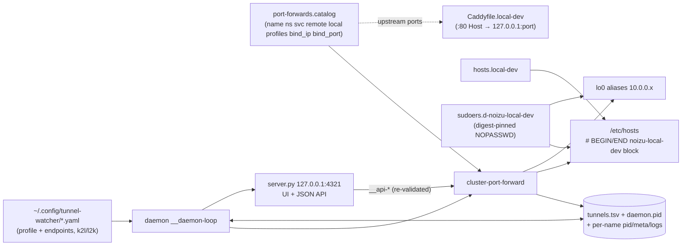
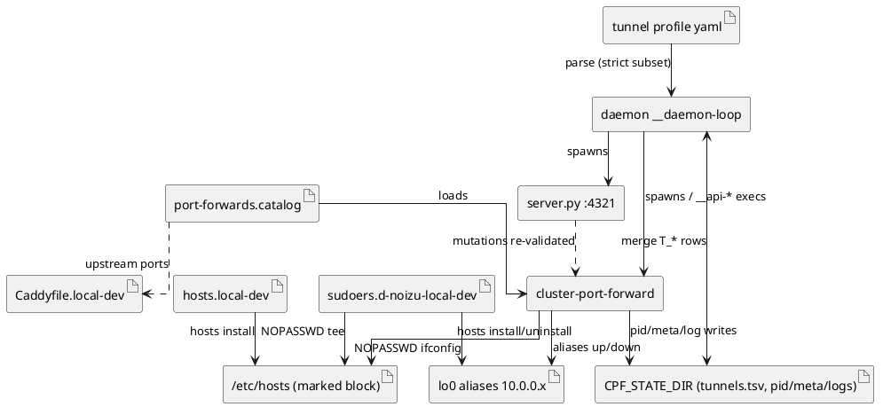

# Data & Config Schema — port-forward-utils

<!-- 〚📁:af6a7a52-00a1-5635-9516-7e11c3afd8c8〛 PROJ-SCHEMA :: Artifact schemas — catalog, tunnel profiles, state files, tunnels.tsv, web API (no DB) -->
> **No persistence layer.** This project has **no database, no SQL schema, and no
> Liquibase changelogs** — ERDs over tables do not apply. `cluster-port-forward`
> is a stateless-per-install bash CLI: durable "data" is flat config under
> `share/` (installed to `~/.local/share/noizu-port-forwards/`) and
> `~/.config/tunnel-watcher/*.yaml`; ephemeral state lives under
> `$CPF_STATE_DIR`. This document is the schema reference for those artifacts.

Config assets: [port-forwards.catalog](../share/port-forwards.catalog) ·
[noizu.yaml.example](../share/profiles/noizu.yaml.example) ·
[hosts.local-dev](../share/hosts.local-dev) ·
[Caddyfile.local-dev](../share/Caddyfile.local-dev) ·
[sudoers.d-noizu-local-dev](../share/sudoers.d-noizu-local-dev)

Artifact relationship map:





---

## 1. Catalog — `share/port-forwards.catalog`

Single source of truth for legacy forward targets. Whitespace-delimited, one
service per line; `#` comments and blank lines ignored. Parsed by
`load_catalog()` into parallel arrays.

| Col | Field | Type | Required | Description |
|-----|-------|------|----------|-------------|
| 1 | `name` | token | Yes | Unique service key (selection id, state filename) |
| 2 | `namespace` | token | Yes | k8s namespace (`-n`) |
| 3 | `service` | token | Yes | k8s Service ref, conventionally `svc/<name>` |
| 4 | `remote_port` | int | Yes | Cluster-side Service port |
| 5 | `local_port` | int | Yes | Loopback high port on `127.0.0.1` (always bound) |
| 6 | `profiles` | CSV | Yes | Comma-separated subset of `data,platform,infra,ai,apps,minio,all` |
| 7 | `bind_ip` | IPv4 | No | Optional lo0 alias (`10.0.0.x`) for secondary PF |
| 8 | `bind_port` | int | No | Port on `bind_ip` (requires col 7; used when `CPF_BIND=1`) |

Example row:

```
app-tsdb  apps  svc/app-timescaledb  5432  54330  data,apps,all  10.0.0.10  5432
```

Current catalog: **18 services** across namespaces `apps`, `platform`,
`infra`, `platform-ai`. Profile semantics: a selection token matches a service
when its `profiles` list contains the token (or token = `all`). Address plan:
`10.0.0.1` edge, `.10–15` data, `.20–22` infra, `.41–44` AI, `.60–64` apps.

Override path: `$CPF_CATALOG`; resolution order otherwise script-relative
`../share/` → XDG data dir → `~/.local/share/noizu-port-forwards/`.

## 2. Tunnel profiles — `~/.config/tunnel-watcher/<name>.yaml`

Strict YAML subset: top-level `key: value` scalars plus one `endpoints:` list
of `- key: value` items (2-space `- `, 4-space continuation, bare scalars,
`#` comments). Anything else fails loudly with a line number. Profile dir:
`$TUNNEL_WATCHER_DIR` (default `~/.config/tunnel-watcher`); profile selected
via `--profile`, else `$TUNNEL_WATCHER_PROFILE`. `make install` seeds
`noizu.yaml` from `share/profiles/noizu.yaml.example` only if absent.

| Field | Level | Type | Default | Description |
|-------|-------|------|---------|-------------|
| `profile` | top | string | — | Profile name |
| `ssh_host` | top | string | — | ssh target for `direction: l2k` endpoints |
| `slug` | endpoint | token | — | Unique row key |
| `namespace` / `service` | endpoint | token | — | k8s target |
| `kind` | endpoint | enum | `service` | `service` \| `pod` \| `deployment` |
| `default_port` | endpoint | even int | — | k2l local port; multi-instance base |
| `instances` | endpoint | bool | `false` | Enumerate pods via svc selector, oldest→newest; instance n local port = `default_port + 2n + 4` |
| `default_instance` | endpoint | enum | `default` | `latest` \| `oldest` \| `num-N` \| `first` |
| `direction` | endpoint | enum | `k2l` | `l2k` = reverse: binds `*:remote_port` on `ssh_host` (needs GatewayPorts clientspecified; doctor checks) |
| `local_port` / `remote_port` | endpoint | int | — | l2k pair (`local_port` odd, on the laptop; `remote_port` on ssh_host) |

Include specs (CLI): `slug`, `slug-oldest/-latest/-num-N/-default`, `slug[:PORT]`
override, `name/namespace[:PORT]` raw catalog bypass. Plan-time overlap:
defaults win, colliding instance rows dropped with a warning (keep ≥20-port
gaps between endpoints).

## 3. Environment variables

| Variable | Default | Purpose |
|----------|---------|---------|
| `KUBECONFIG` | `~/.kube/noizu/config` | Exported for all kubectl calls |
| `KUBE_CONTEXT` | *(unset)* | Adds `--context` to kubectl |
| `CPF_STATE_DIR` | `${XDG_RUNTIME_DIR:-/tmp}/noizu-port-forwards` | Runtime state root |
| `CPF_CATALOG` | *(resolved share path)* | Catalog override |
| `CPF_HOSTS_FILE` | *(resolved `hosts.local-dev`)* | Hosts-block source |
| `CPF_BIND` | `1` | Also PF to `bind_ip:bind_port` when set in catalog |
| `CPF_POLL_SEC` | `3` | Supervisor poll interval |
| `CPF_LOG` | `$CPF_STATE_DIR/supervisor.log` | Supervisor log path |
| `TUNNEL_WATCHER_PROFILE` | *(unset)* | Default tunnel profile name |
| `TUNNEL_WATCHER_DIR` | `~/.config/tunnel-watcher` | Tunnel profile config dir |
| `CPF_WEB_PORT` | `4321` | Daemon web/API bind port (loopback only) |

No secret-bearing env vars — credentials stay in Infisical / dc / k8s secrets.

## 4. CLI grammar (`cluster-port-forward`)

```
cluster-port-forward <command> [args…]
  # legacy catalog surface
  start   [profile|name …]     # default selection: data
  watch   [profile|name …]     # alias: supervise
  stop    [name|all]
  status                       # alias: st; status --profile P filters
  list                         # alias: ls
  doctor                       # alias: check
  hosts   print|show|blurb|copy|install|uninstall   # default: print
  aliases up|down|status       # alias: alias; default: status
  # tunnel-profile surface
  up      [spec …] [--profile P] [--timeout DUR] [--json] [--dry-run] [--watch] [--tui]
  tui                          # ANSI table, drill ns→svc→pods, persist ports
  daemon  start|stop|restart|status|logs|install|uninstall
  profile-parse                # debug: dump normalized endpoints
  help | -h | --help
```

Selection tokens: a profile name (`all|data|platform|infra|ai|apps|minio`), an
exact catalog `name`, or an include spec (`slug`, `slug-oldest/-latest/…`,
`slug[:PORT]`, `name/namespace[:PORT]`); deduplicated in order. Hidden
commands (`__daemon-loop`, `__api-*`) are daemon/web plumbing, not operator
surface.

## 5. Runtime state — `$CPF_STATE_DIR` (ephemeral)

Files created/removed by the tool; safe to delete when nothing is running.

| File | Format | Writer | Lifetime |
|------|--------|--------|----------|
| `<name>.pid` | single pid, or literal `external` | `start_pf` | per forward |
| `<name>.bind.pid` | single pid (secondary bind_ip PF) | `start_pf` | per bind forward |
| `<name>.meta` | `key=value` lines: `name ns svc remote local bind_ip bind_port` | `start_one` | per service |
| `selection.txt` | one name per line | `cmd_start` / `cmd_watch` | session |
| `<name>.kubectl.log`, `<name>-bind.kubectl.log` | raw kubectl output | kubectl | session |
| `supervisor.log` | `ISO-timestamp message` lines | `log()` | session |
| `tunnels.tsv` | pipe-delimited rows, 13 columns (below) | daemon (`tw_state_persist`) | daemon lifetime; merged, foreign keys preserved |
| `daemon.pid` | daemon pid | `daemon start` / launchd | daemon lifetime |
| `daemon.log` | daemon stdout/err | daemon | daemon lifetime |

### `tunnels.tsv` row layout (13 pipe-separated columns)

| # | Field | Meaning |
|---|-------|---------|
| 1 | `key` | unique row id (`T_*`) |
| 2 | `slug` | profile endpoint slug |
| 3 | `kind` | `service` \| `pod` \| `deployment` |
| 4 | `direction` | `k2l` \| `l2k` |
| 5 | `namespace` | k8s namespace |
| 6 | `target` | `svc/…` / `pod/…` / `deploy/…` ref |
| 7 | `local_port` | laptop-side port (k2l loopback; l2k local service) |
| 8 | `remote_port` | cluster-side port (k2l svc port; l2k port on ssh_host) |
| 9 | `pod` | resolved pod name (instance rows), else empty |
| 10 | `pid` | owning process pid (kubectl/ssh), empty when down |
| 11 | `started` | epoch seconds |
| 12 | `restarts` | supervisor restart count |
| 13 | `label` | display label |

`external` pid value = local port was already open; tool never kills it.
The web server re-derives `state` (`online`/`port-up`/`offline`) at read time
from pid liveness + socket probes; it is not stored.

## 6. Web/API — `127.0.0.1:$CPF_WEB_PORT` (daemon-spawned `server.py`)

Loopback bind only; python3 stdlib; no auth (any local process can call it —
see THREAT-MODEL). GETs read `tunnels.tsv` + socket probes; POSTs are
regex-validated then exec'd as hidden `__api-*` CLI commands
(`CPF_API_INTERNAL=1`), so every mutation is re-validated by the profile/spec
parser — never interpolated raw into shell commands.

| Endpoint | Method | Body / Params | Behavior |
|----------|--------|---------------|----------|
| `/api/health` | GET | — | daemon liveness + profile + tunnel count |
| `/api/tunnels` | GET | — | rows (slug/ns/target/pod/dir/local/remote/state/uptime/restarts) + supervisor pid + profile; 503 body still carries rows when degraded |
| `/api/up` | POST | `{profile, include[], timeout}` | plan + start via daemon |
| `/api/down` | POST | `{slug[] \| all}` | stop tunnels |
| `/api/restart` | POST | `{slug}` | restart one row |
| `/api/repoint` | POST | `{local_port, pod}` | rebind row to a pod (existence checked via read-only get; 400 on unknown) |
| `/api/setport` | POST | `{slug, port}` | even ports only; persists into profile yaml (TUI `p` semantics) |
| `/api/reload` | POST | — | re-read profile from disk |

## 7. `/etc/hosts` managed block

`hosts install` rewrites `/etc/hosts` (via digest-pinned `sudo tee`) keeping an
idempotent block:

```
# BEGIN noizu-local-dev
…contents of share/hosts.local-dev…
# END noizu-local-dev
```

Source lines: `IP  hostname [alias…]` — every name dual-written as `*.dev` and
`*.dev.noizu.local`. `install` replaces the existing block; `uninstall` removes it.

## 8. sudoers template — `share/sudoers.d-noizu-local-dev`

macOS-only. Grants NOPASSWD for exactly three command classes, each sha256
digest-pinned: `ifconfig lo0 ±alias <ip> netmask 255.255.255.0` for the 19
catalog alias IPs (`NOIZU_IFCONFIG_ALIAS` / `_UNALIAS`), and `/usr/bin/tee
/etc/hosts` (`NOIZU_HOSTS_TEE`). Digests must be regenerated after OS updates
(`shasum -a 256 /sbin/ifconfig /usr/bin/tee /bin/cp`); user placeholder
`keithbrings` must be edited before install.

## 9. Caddy edge — `share/Caddyfile.local-dev`

Static config, no state: global block (`auto_https off`, `admin off`), a
`local.dev` health responder, then one site block per HTTP service mapping
`<name>.dev` + `<name>.dev.noizu.local` → `127.0.0.1:<catalog local_port>`.
Must be kept in sync manually with catalog local ports (ports 18081, 16333,
18080, 9000/9001, 14000, 13000, 14040, 13040, 14041).

---

**Integrity rules**: catalog `name` uniqueness (state filenames derive from it);
`bind_port` requires `bind_ip`; `tunnels.tsv` `key` uniqueness (merge keeps
foreign rows); `setport` accepts even ports only; hosts block markers
exact-match; sudoers digests pin macOS binary paths — do not hand-edit alias
IP lists without regenerating.
