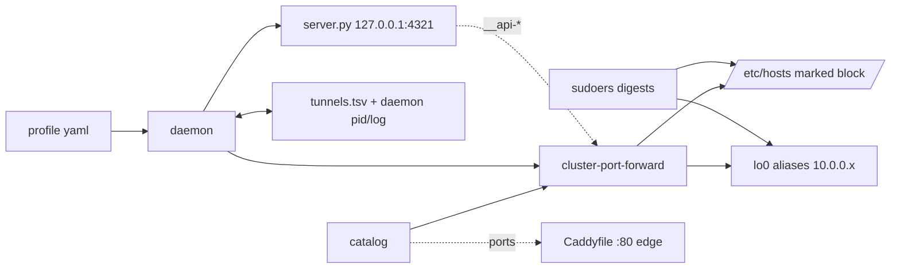

# Data & Config Schema — Summary

**No persistence layer** — no DB/SQL schema; flat config + ephemeral state only.
Full reference: [PROJ-SCHEMA.md](PROJ-SCHEMA.md).

| Artifact | Kind | Format |
|----------|------|--------|
| `share/port-forwards.catalog` | config (source of truth) | 8-col whitespace rows: `name ns svc remote_port local_port profiles[CSV] [bind_ip bind_port]`; 18 services; profiles `data,platform,infra,ai,apps,minio,all` |
| `~/.config/tunnel-watcher/*.yaml` | tunnel profiles | strict YAML subset: top scalars + `endpoints:` list (`slug/ns/service/kind/default_port/instances/default_instance/direction/local_port/remote_port`); l2k reverse via `ssh_host`; multi-instance base + 2n + 4 |
| env vars (`KUBECONFIG`, `CPF_*`, `TUNNEL_WATCHER_*`) | runtime config | 11 vars, no secrets |
| CLI grammar | interface | legacy `start · watch · stop · status · list · doctor · hosts · aliases` + profile `up · tui · daemon · profile-parse` |
| `$CPF_STATE_DIR/*` | ephemeral state | `<name>.pid` (`external` sentinel), `.bind.pid`, `.meta`, `selection.txt`, logs + daemon `tunnels.tsv` (13 pipe cols), `daemon.pid`, `daemon.log` |
| web API `127.0.0.1:4321` | interface | GET `/api/health`, `/api/tunnels`; POST `/api/up·down·restart·repoint·setport·reload` — regex + CLI re-validated |
| `/etc/hosts` block | managed output | `# BEGIN/END noizu-local-dev` markers, idempotent rewrite |
| `share/sudoers.d-noizu-local-dev` | host config (macOS) | sha256 digest-pinned NOPASSWD `ifconfig`/`tee` |
| `share/Caddyfile.local-dev` | edge config | static Host-route :80 → 127.0.0.1 high ports |

