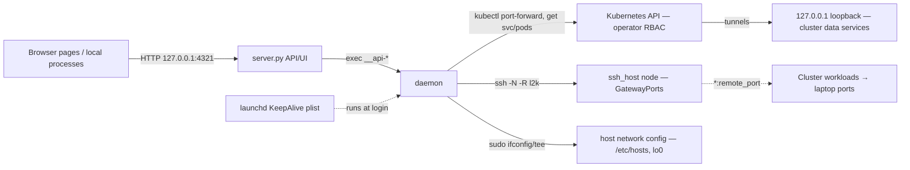

# Threat Model — port-forward-utils

<!-- 〚📁:276ac5af-7659-54ef-ad6e-0d03a053e3aa〛 THREAT-MODEL :: Security threat model — trust boundaries, STRIDE register T-001..T-009 -->
## Overview

`cluster-port-forward` is a developer-laptop tool: it uses the operator's
cluster credentials (kubeconfig, ssh key for `ssh_host`) to punch tunnels —
**cluster data services onto the laptop loopback**, and (opt-in, `direction:
l2k`) **local laptop services back into the cluster**. It stores no secrets
itself; its privilege is exactly the operator's own kubectl/ssh authority.

**Crown jewels:** the operator's kubeconfig and ssh identity (used by the
tool's child processes), and the cluster data services (TSDB, Valkey, MinIO,
Infisical, AI stores) that become reachable on `127.0.0.1` while tunnels are
up. The tool is local-dev posture: single-user laptop, no multi-tenant
surface.

→ *Grounding: [PROJ-ARCH.md](PROJ-ARCH.md) · directories: [PROJ-LAYOUT.md](PROJ-LAYOUT.md) · artifact schemas: [PROJ-SCHEMA.md](PROJ-SCHEMA.md)*

## Trust boundaries

| Boundary | Crossing | Enforcement |
|----------|----------|-------------|
| Host loopback ↔ web API | any local process; browser POSTs | bind `127.0.0.1` only; regex validation; mutations re-parsed by CLI (`__api-*`, `CPF_API_INTERNAL=1`) |
| Laptop ↔ cluster (k2l) | kubectl with operator kubeconfig | API-server RBAC on the operator's identity; ports bind loopback |
| Laptop ↔ cluster (l2k) | ssh -N -R binds `*:remote_port` on ssh_host | opt-in `direction: l2k`; sshd GatewayPorts clientspecified (doctor checks); ≥20-port spacing guidance |
| Tool ↔ host network config | `sudo ifconfig lo0`, `sudo tee /etc/hosts` | digest-pinned NOPASSWD sudoers (3 command classes, explicit IPs) |

→ *Attack-surface detail and per-endpoint notes in PROJ-ARCH § Web/API*

## Vulnerability register

| ID | Severity | STRIDE | Component | Status |
|----|----------|--------|-----------|--------|
| T-001 | Medium | Tampering / Info disclosure | Web API (`share/web/server.py`) has no Origin/Host-header validation — a malicious page visited in any browser can drive blind CSRF POSTs (`/api/down`, `/api/restart`, `/api/repoint`, `/api/setport`) against the loopback API | **Open** — suggested mitigation: Origin/Host allowlist or secret request token |
| T-002 | Low | Elevation of privilege | Any local process can call the unauthenticated API and make the daemon spend the operator's kubectl/ssh authority (tunnels only; API-server RBAC still gates what is reachable; `/api/repoint` requires an existing pod) | Accepted — API privilege ≤ operator's own CLI privilege; loopback bind |
| T-003 | High | Info disclosure / EoP | `direction: l2k` reverse tunnels expose laptop ports cluster-wide (`*:remote_port` on ssh_host with GatewayPorts clientspecified) | Mitigated — opt-in per endpoint, doctor GatewayPorts + reachability checks, ≥20-port spacing, ssh to pinned alias; residual: any cluster workload can reach exposed ports while up |
| T-004 | Medium | Tampering | `hosts install` / `aliases up` rewrite host network config via sudo | Mitigated — sha256 digest-pinned NOPASSWD for exactly `ifconfig lo0 ±alias` (19 IPs) and `tee /etc/hosts`; managed block markers idempotent; template user placeholder must be edited before install |
| T-005 | Low | Denial of service | Supervisor loops could hammer the API server on flapping tunnels | Mitigated — per-key exponential backoff (cap 60s), 3s default poll, short socket-probe timeouts |
| T-006 | Low | Info disclosure | State files (`tunnels.tsv`, `daemon.log`, per-name meta/logs) under `$XDG_RUNTIME_DIR` or `/tmp` fallback leak tunnel topology (ns/svc/pod names, ports) to local users | Accepted — no credentials in state; `/tmp` fallback only when `XDG_RUNTIME_DIR` unset |
| T-007 | Low | Spoofing | Wrong `KUBECONFIG`/`KUBE_CONTEXT` could tunnel against an unintended cluster | Mitigated — explicit env overrides, `doctor` verifies reachability + catalog Service existence before/while use |
| T-008 | Low | Supply chain | Tool runs on the operator's credentials from a repo checkout | Mitigated — single bash script + python3 stdlib (no runtime deps), installs only via `make install`; 157-assertion test suite runs against fake kubectl/ssh, never a real cluster; launchd plist content asserted, `launchctl` never invoked in tests |
| T-009 | Low | Repudiation | Tunnel start/stop/restart actions are logged only locally (`daemon.log`, `supervisor.log`) | Accepted — single-operator local-dev tool; timestamps in logs |

## Mitigation coverage

6 mitigated · 2 accepted · 1 open. Open: **T-001** (web API Origin/Host
validation) — the one gap not covered by loopback binding alone.

## Residual risk

- **l2k exposure (T-003 residual):** while a reverse tunnel is up, cluster
  workloads reaching the node IP can connect to the developer's local service.
  Accepted for local-dev; doctor warns on missing GatewayPorts and tight port
  spacing.
- **CSRF (T-001):** blind mutation of local dev tunnels by drive-by web pages;
  no secret exfiltration (responses are not readable cross-origin). Rated
  Medium because `/api/setport` persists into the profile and `/api/repoint`
  rebinds rows.
- **State on `/tmp` (T-006):** topology visibility only; no creds, no data
  plane payload.

## Related docs

- Architecture: [PROJ-ARCH.md](PROJ-ARCH.md)
- Artifact/API schemas: [PROJ-SCHEMA.md](PROJ-SCHEMA.md)
